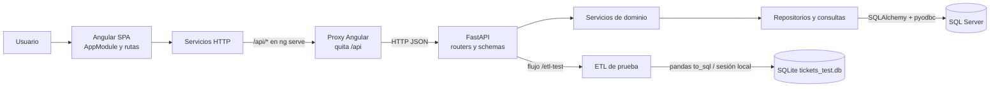
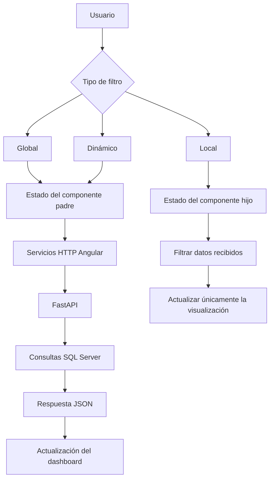

# Arquitectura

## Vista general

El repositorio contiene una aplicación web Angular y una API Python/FastAPI. Angular consume la API por HTTP y recibe respuestas JSON. La API organiza el código en controladores, schemas, servicios y repositorios. SQL Server es el almacén usado por la mayoría de los dominios funcionales; existe además un flujo ETL de prueba que persiste en SQLite.

El proxy `/api` solo está configurado en el servidor de desarrollo Angular. `fronted-tickets/proxy.conf.json` lo dirige a `http://127.0.0.1:8080` y elimina el prefijo antes de reenviar. FastAPI declara CORS para `http://localhost:4200`. No se encontró configuración de proxy o publicación de frontend para producción en los archivos revisados.

## Frontend

La aplicación usa Angular con `AppModule` y `AppRoutingModule`; los componentes se declaran en el módulo raíz. Las rutas de `src/app/app-routing-module.ts` conectan páginas con vistas de inicio, login, SLA, consolidados, importaciones, chat IA, auditoría de categorización, análisis de causa, reporte diario y tareas.

- `components/pages/`: páginas y sus vistas.
- `components/charts/`: gráficos, tablas, KPI y exploradores reutilizables, agrupados por dominio.
- `components/layouts/` y `components/sidenav/`: estructura y navegación.
- `services/`: clientes HTTP Angular; por ejemplo, `HomeService` consulta `api/home/resumen` y `AiChatService` llama a `api/ai-chat/...`.
- `models/`: tipos TypeScript de solicitudes y respuestas.
- `material/`, `material-theme.scss` y `styles.css`: integración de Angular Material y estilos globales.

La visualización usa Chart.js con `ng2-charts`. Los formularios incluyen Reactive Forms y controles Angular Material. No se observa una configuración de estado global dedicada en los archivos revisados.

### Reporte PNG de Auditoría de Categorización

`RequirementCategorizationAudit` reutiliza las cuatro respuestas agregadas existentes (`summary`, `resolvers`, `monthly-stats`, `resolution-reasons`) para construir una instantánea `RequirementCategorizationReportData`. Se conserva el componente presentacional `app-requirement-categorization-report`, declarado en `AppModule`, y el único botón «Descargar Reporte PNG». No cambian servicio, modelos compartidos, backend ni dependencias.

- El documento ejecutivo presenta tres KPI y cuatro gráficos en cuadrícula 2×2: distribución de categorizaciones y motivos en la primera fila; Top 10 por incorrectas y barras mensuales en la segunda. La franja inferior tiene tres hallazgos, una conclusión y tres recomendaciones. Las dos tablas estadísticas desaparecen solo del PNG; las tablas y demás componentes interactivos del dashboard se mantienen.
- La instantánea copia filtros efectivos: fechas, grupo, proyecto, resultado, motivo, mes, colaborador y ticket. Los cambios de formulario pendientes y paginación/búsquedas locales no alteran el alcance. Se muestran período, grupo, proyecto completo cuando esté filtrado y filtros aplicados.
- Cada actualización invalida instantánea y renderizado e incrementa la versión. Solo cuatro respuestas exitosas y coherentes habilitan su preparación; cero tickets o un `404` no habilitan descarga. Tickets pendientes, errores de su página o paginación no bloquean agregados válidos.
- `requirement-categorization-report.utils.ts` contiene validación y análisis determinísticos, sin HTTP ni IA. Se reconcilian cantidades y tasas redondeadas a dos decimales conforme al universo vigente por ticket en ejecuciones completadas. Los errores de ejecuciones y contadores de filas no son denominadores de tickets. No se exige continuidad de meses ni que porcentajes redondeados sumen exactamente 100.
- El Top 10 ordena incorrectas descendentes, total descendente y nombre; conserva cero incorrectas si corresponden a la selección. Distingue cantidad absoluta de tasa individual, sin alterar totales generales ni ranking del dashboard. Las donas conservan todas las categorías, incluido `SIN_DATO`; los meses se ordenan sin inventar períodos.
- Se reutiliza el CSS ejecutivo de R01 sin modificarlo. HTML/CSS y SVG estáticos con fuente local, ancho 1400 px CSS y altura inferior a 1400 px. El hijo espera fuentes y dos ciclos de pintura, comprueba cuadrícula, dimensiones, textos SVG y desbordamientos, y confirma la versión. La espera vence a los 30 segundos y se cancela al cambiar revisión o destruir el componente.
- El padre conserva `html-to-image`, revalidación antes/después de captura, doble clic protegido, limpieza del enlace y descarte al abandonar la página. La espera previa y captura tienen timeout de 30 segundos cada una. La escala es 2, con límites de 16384 px por lado y 32 millones de píxeles. Un rango demasiado denso o texto que no cabe genera un mensaje; no se trunca ni recorta contenido para forzar la descarga.
- La descarga no consulta endpoints adicionales. Un fallo de captura libera el estado y permite reintentar sin recargar. El nombre de archivo existente se conserva y la fecha de preparación se muestra en ISO.

Los agregados son consultas independientes: versión y conciliación de conteos no constituyen una instantánea transaccional del servidor. Reglas y aceptación: [PRD 02](requirements/02_reporte_png_auditoria_categorizacion_PRD.md). Evidencia ejecutada y pendientes: [TEST_PLAN.md](TEST_PLAN.md#reporte-png-de-auditoría-de-categorización).

### Reporte PNG de Tiempos de Informes Mensuales

`TicketsReportTimes` prepara una instantánea `TicketsReportTimesReportData` con las seis respuestas del dashboard: KPI, volumen mensual, tabla y ranking por resolutor, tabla y ranking por proyecto. El componente `app-tickets-report-times-report`, declarado una sola vez en `AppModule`, es presentacional y no utiliza servicios HTTP. Se reutilizan `TicketsReportTimesService`, sus modelos y `html-to-image`; no se modifican endpoints ni backend.

- El PNG contiene exactamente seis secciones: KPIs de Análisis de Tiempos, Resumen Ejecutivo Mensual, Horas Registradas por Resolutor, Detalle de Tiempos por Resolutor, Horas Registradas por Proyecto y Mes y Detalle de Tiempos por Proyecto. Conserva los cuatro KPIs visibles: tickets, horas, proyectos y resolutores. Los gráficos mantienen el Top 10 existente; las matrices incluyen todas las entidades.
- Las tablas del dashboard reciben páginas de hasta 100 registros mensuales. El padre conserva la primera respuesta y completa únicamente las páginas faltantes mediante los dos endpoints existentes, con una cola compartida de dos solicitudes simultáneas y 30 segundos de espera por petición adicional. Las páginas correctas se conservan para reintentos de la misma versión. La colección del reporte no sustituye la página visible ni modifica sus controles.
- Se comprueban metadatos y cantidad final de registros, claves duplicadas entre páginas, números válidos, igualdad de resúmenes y coherencia de acciones y horas. El margen para sumar cantidades redondeadas es `0.005 × (cantidad de sumandos + 1)` más una tolerancia numérica mínima. Los tickets únicos se toman del KPI/resumen; no se reconstruyen sumando resolutores, proyectos o meses.
- Los filtros del snapshot son fechas, grupo, proyectos y mes efectivamente aplicados. Las búsquedas, indicadores y selecciones locales del dashboard no se exportan. El resumen ejecutivo conserva todo el rango y resalta el mes seleccionado; los KPIs y el detalle sí usan ese mes. El backend actual aplica los proyectos también al KPI y al volumen, aunque la nota del dashboard describe un alcance menor; no se altera esa regla en este cambio.
- Cada recarga o limpieza invalida el reporte y cancela las páginas pendientes. El control de solicitudes descarta respuestas anteriores; una versión adicional de presentación evita aceptar confirmaciones de renderizado anteriores incluso al reintentar con los mismos filtros. El botón espera seis respuestas correctas, tablas completas, datos válidos y confirmación del hijo. Cero tickets mantiene la descarga deshabilitada. Una paginación visual posterior, incluso si falla, no bloquea un snapshot ya completo.
- La presentación utiliza HTML/CSS y SVG estáticos, fuente local y paleta CANVIA. El documento mide 1400 px de ancho, queda fuera del viewport y espera las fuentes y dos ciclos de pintura. Los meses se distribuyen en bloques de hasta seis; las matrices repiten las entidades y la columna «Total del período», identificada expresamente. Los totales de celdas son sumas de horas redondeadas, diferenciadas de los agregados generales.
- El padre captura `.report-document` con `toPng`, `skipFonts` y `skipAutoScale`. Escala 2 hasta 4000 px de altura; escala 1 para documentos más largos. Rechaza lados de salida mayores de 16384 px o más de 32 millones de píxeles y solicita reducir filtros, sin truncar registros. El nombre es `CANVIA-Tiempos-Informes-Mensuales-{desde}_{hasta}-{mes-o-todos}-{fecha-descarga}.png`.
- La captura se valida antes y después de generar la imagen, se impiden descargas simultáneas y se limpia el enlace temporal. Hay mensajes y reintento para páginas, renderizado y captura. Salir de la página descarta la descarga pendiente.

Las consultas independientes no ofrecen una instantánea transaccional SQL Server: se detectan inconsistencias observables, pero cambios concurrentes que preserven los mismos agregados pueden pasar inadvertidos. Las horas representan acciones registradas, no duración calendario ni SLA. Evidencia y pendientes: [TEST_PLAN.md](TEST_PLAN.md#reporte-png-de-tiempos-de-informes-mensuales).

### Reporte PNG R01 de Incidentes Consolidados

`IncidentConsolidated` reutiliza la respuesta vigente de `obtenerVolumenMensual`, sin consultas adicionales ni cambios al servicio HTTP o al backend. Captura una copia profunda de los filtros enviados, excluyendo únicamente `periodo`, y los límites generales de disponibilidad de `/filters` existentes al iniciar esa misma solicitud. Los cambios de formulario pendientes de aplicar no forman parte del documento.

- `IncidentMonthlyReportData` es la instantánea tipada. Las funciones puras de `incident-monthly-report.utils.ts` validan registros, ordenan año/mes, completan ceros dentro del rango y calculan todos los KPI y textos desde esa única serie. Una respuesta completamente vacía no se convierte en una serie inventada. Se rechazan fechas/cantidades inválidas, meses duplicados o fuera del rango y totales que exceden la precisión de enteros seguros.
- Total, máximos y mínimos incluyen todos los meses visibles, también ceros y parciales. Los extremos empatados se presentan cronológicamente, indicando la cantidad adicional de meses empatados. Para límites no especificados se usan los meses extremos de la respuesta como eje visual; el encabezado conserva el alcance solicitado sin inventar límites de consulta.
- Un mes comparable debe estar cerrado según la fecha de preparación en `America/Lima` y completamente cubierto tanto por el rango aplicado como por `fecha_min`/`fecha_max` de disponibilidad general. Los meses sin ambos límites conocidos llevan cobertura no confirmada; los límites parciales y meses actuales/futuros se excluyen de comparaciones. La disponibilidad es global, no acredita exhaustividad de importaciones ni continuidad de cargas o cobertura particular de cada proyecto/grupo.
- Las variaciones solo unen meses completos consecutivos; la variación general describe el cambio neto de ese tramo continuo, sin afirmar una tendencia sostenida. Una base cero conserva la diferencia absoluta y no genera tasa porcentual. Los hallazgos priorizan máximo, mayor crecimiento porcentual (o absoluto si todas las bases son cero), mayor reducción porcentual y variación general; omiten casos inexistentes y cambios generales que repiten una variación ya descrita. Los empates de tasas se resuelven cronológicamente. La conclusión y una recomendación se generan mediante reglas, sin GPT ni edición manual.
- El padre invalida el reporte al iniciar la carga mensual, al excluir proyectos antes del debounce y al abandonar la página; reutiliza `solicitudDashboard` y añade la versión de presentación para descartar respuestas y renders antiguos, incluidos reintentos de la misma consulta. La consulta mensual tiene timeout de 30 segundos. Fallos HTTP no habilitan la exportación de datos antiguos; cero incidentes mantiene el botón deshabilitado.
- `IncidentMonthlyReport`, ya declarado en `AppModule`, recibe solo datos y confirma renderizado por versión tras esperar fuentes, dos ciclos de pintura y dimensiones válidas; limita la espera a 30 segundos. Renderiza anticipadamente para reutilizar el protocolo de los reportes existentes. R01 espera únicamente su fuente y su render; otras consultas, errores y paginaciones del dashboard no condicionan su descarga.
- El botón naranja «Descargar» está a la derecha de «Gráficos Principales». El documento de 1400 px CSS queda fuera de pantalla y usa composición de infografía ejecutiva: cabecera azul con icono cloud/servidores, separador naranja y curvas decorativas; filtros efectivos en una línea flexible; tres KPI con iconos, separadores y acento inferior; paneles centrales 60/40 con encabezados azules en degradado, iconos naranjas y esquina diagonal. El gráfico SVG usa barras en degradados naranja/amarillo/verde, eje y cantidades visibles y meses con año. Se distribuyen hasta 18 meses por bloque, reduciendo el límite para cifras largas y equilibrando los bloques para evitar uno final casi vacío. Los hallazgos conservan literalmente sus textos; el componente los divide en fragmentos escapados para destacar números y porcentajes, sin HTML dinámico. La conclusión y recomendación se integran en una franja ejecutiva inferior y las advertencias metodológicas permanecen al pie. Los atributos SVG explícitos preservan fuentes y colores en PNG. Solo cambia la presentación, sin alterar cálculos, filtros, protocolo de render ni exportación.
- La captura reutiliza `html-to-image/toPng`, `skipFonts` y `skipAutoScale`: escala 2 hasta 4000 px de altura y escala 1 para documentos mayores; rechaza más de 16384 px por lado o 32 millones de píxeles sin truncar. Comprueba vigencia antes/después, impide descargas simultáneas y limpia el enlace temporal. Permite reintentar render o captura sin HTTP adicional; los fallos de consulta reintentan únicamente el volumen mensual.

La consistencia garantizada es la del documento frente a una respuesta y sus filtros capturados. `/filters` y el volumen son consultas separadas y no constituyen una instantánea transaccional SQL Server. Evidencia y límites pendientes: [TEST_PLAN.md](TEST_PLAN.md#reporte-png-r01-de-incidentes-consolidados).

### Reporte PNG R02 de Incidentes Consolidados

El módulo contempla exactamente cuatro reportes (R01–R04), según el [PRD 05](requirements/05_reportes_descargables_incidentes_consolidados_PRD.md). R02 incorpora el botón naranja «Reporte 2» a la derecha de «Empresa»; R01 conserva sus archivos y comportamiento.

- El padre coordina una carga independiente con `forkJoin` de `/kpis`, `/proyectos`, `/top-proyectos` y `/volumen-mensual`, mediante el servicio existente. Las cuatro solicitudes reciben la misma copia de `desde`, `hasta`, `prioridad`, `motivo_estado`, `motivo_resolucion`, `grupo_resolutor` y `proyectos_excluidos`. Una lista positiva descarta todos los filtros dinámicos sin modificar el dashboard. Se exige un rango válido explícito porque el ranking sin fechas utiliza su propio rango predeterminado.
- `IncidentProjectReportData` contiene la instantánea validada. Las funciones puras reconcilian el KPI con la distribución completa y el volumen mensual; cada proyecto del Top 10 debe coincidir con su distribución y detalle mensual. El subtotal Top 10 se identifica separadamente. La dona usa el total de todos los proyectos, muestra los cinco principales y agrupa el resto como «Otros», incluso cuando su cantidad es cero.
- Los tres KPI incluyen todos los meses visibles. Las reglas de cobertura, ceros, meses parciales y comparaciones consecutivas se reutilizan de las utilidades de R01, sin alterarlas. Tres hallazgos describen demanda, concentración y el último par comparable, o su ausencia; una conclusión y tres recomendaciones proceden de reglas TypeScript, sin GPT ni atribuciones causales.
- `IncidentProjectReport` es presentacional y reutiliza los estilos ejecutivos de R01 mediante importación CSS. El documento mide 1400 px CSS: cabecera y KPI compactos, fila central 65/35 y fila inferior de tres columnas. El Top 10 utiliza un único SVG de barras verticales agrupadas con leyenda superior de meses; la dona conserva Top 5 + Otros, total en el centro y leyenda a su derecha. La tendencia general usa una única línea SVG con todos los puntos mensuales, incluidos ceros y parciales, sin subdividir el rango en gráficos apilados. Los puntos huecos señalan cobertura parcial/no confirmada; no cambian las reglas de comparación.
- El TS presentacional adapta geometría y etiquetas al espacio disponible. En rangos densos, el Top 10 etiqueta el máximo mensual de cada proyecto y lo indica expresamente, conservando todas las barras. La línea espacia etiquetas numéricas/de eje cuando hace falta, sin eliminar puntos y conservando los extremos. Los nombres se muestran completos en líneas; solo los que exceden siete líneas usan una clave acompañada del nombre íntegro debajo del gráfico. Las advertencias metodológicas y los filtros efectivos permanecen visibles. Se conservan literalmente los tres hallazgos, la conclusión y las tres recomendaciones de la instantánea.
- La descarga prepara el documento al solicitarla y espera fuentes, dos ciclos de pintura y confirmación de dimensiones/versiones. Se cancelan solicitudes y capturas al cambiar filtros efectivos o abandonar la página; cambiar únicamente filtros dinámicos no invalida R02. Hay timeout de 30 segundos, protección contra doble descarga y reintentos: HTTP repite las cuatro consultas; render/captura reutilizan la instantánea válida.
- La captura usa `html-to-image/toPng` existente con las opciones y controles de R01: escala 2 hasta 4000 px CSS de altura, escala 1 por encima, máximo 16384 px por lado y 32 millones de píxeles. Comprueba vigencia antes y después de capturar, limpia el enlace temporal y rechaza desbordamientos de dimensiones sin truncar datos. No añade dependencias, endpoints ni cambios backend.

La revisión de consumidores y agregaciones confirma denominadores compatibles cuando los filtros son idénticos. Las cuatro consultas no son una transacción del servidor: se detectan diferencias observables, pero cambios concurrentes que conserven los agregados pueden pasar inadvertidos. La cobertura general de registros no acredita exhaustividad de importaciones. Evidencia y límites: [pruebas de R02](TEST_PLAN.md#reporte-png-r02-de-incidentes-consolidados).

### Reporte PNG R03 de Incidentes Consolidados

El botón «Reporte 3», junto a «Reporte 2» en Empresa, obtiene la identidad exclusivamente de `proyectoSeleccionado`. Sin selección o fechas efectivas válidas queda deshabilitado. Respeta la conciliación existente: seleccionar reincluye ese proyecto y excluirlo elimina su selección; R03 rechaza también cualquier conflicto residual. No modifica los componentes/modelos/utilidades propios de R01/R02 ni sus estados de exportación.

- El padre captura una lista positiva de filtros: fechas, prioridad, motivos de estado/resolución, grupo resolutor, exclusiones compatibles y proyecto explícito. No utiliza filas visibles, paginación, otros filtros dinámicos ni cambios pendientes del formulario. Ejecuta `obtenerKpis` y `obtenerTopProyectos` con la misma copia y timeout de 30 segundos, sin consultar volumen mensual ni modificar el servicio HTTP.
- La revisión estática de `obtener_top_proyectos_mensual` y `obtener_top_proyectos` confirma que el repositorio aplica `proyecto` antes de agrupar y el servicio limita el ranking después. Con fechas explícitas y registros, devuelve todos los períodos con ceros. R03 exige exactamente la identidad seleccionada, períodos/celdas únicos y completos, cantidades seguras y suma mensual = total del proyecto = KPI. Cero tickets no genera PNG; una inconsistencia bloquea la preparación. Las consultas no garantizan una transacción del servidor.
- `IncidentProjectMonthlyReportData` conserva identidad, filtros, fecha de preparación, serie y resultados ejecutivos. La función pura de R03 adapta el ranking al contrato de `crearReporteMensual`: registros año/mes/cantidad, filtros, disponibilidad, versión/solicitud y fecha. R01 copia entradas, ordena/completa meses y expone variaciones consecutivas; no expone la variación general, que R03 calcula por separado. Ninguna selección o estado de R01/R02 se reutiliza para coordinar R03.
- KPI total y máximo usan todos los meses visibles. La variación del período compara los extremos de un tramo continuo de al menos dos meses completos; identifica ambos meses y conserva diferencia absoluta si la base es cero, con porcentaje no calculable. Reutiliza exactamente la cobertura de calendario de R01: fechas aplicadas, disponibilidad general y cierre del mes en Lima. No acredita exhaustividad de importaciones ni cobertura específica del proyecto.
- Tres hallazgos priorizan cambio general, incremento y reducción, sin repetir el mismo par. Los empates son cronológicos; las tasas definidas se priorizan sobre crecimientos de base cero, que se ordenan por diferencia absoluta. El seguimiento del mes completo inmediatamente posterior a una caída distingue repunte parcial de recuperar el nivel previo. Máximo, meses cero y cobertura completan los hechos faltantes. Una conclusión y tres recomendaciones se generan sin GPT ni atribuciones causales.
- `IncidentProjectMonthlyReport` es presentacional, reutiliza CSS ejecutivo de R01 por importación y recibe solo `datos`. Cabecera con nombre íntegro, tres KPI y cuerpo 62/38: un único SVG mensual a la izquierda y hallazgos/conclusión/recomendaciones a la derecha. Muestra todas las barras, cantidades y meses; gira etiquetas 90° cuando es necesario, con fuente mínima aproximada de 12 px CSS. Muestra hasta las tres últimas variaciones comparables bajo el gráfico y conserva filtros/metodología al pie.
- El hijo confirma la versión tras fuentes, dos pinturas y validación de ancho, cajas reales de texto SVG y composición horizontal. El espacio mínimo por mes, solapamientos o altura de 1400 px CSS o más bloquean la exportación con mensaje para reducir fechas, sin fragmentar ni recortar. Los fallos distinguen `legibilidad` de `render` mediante un evento tipado propio de R03.
- R03 mantiene sus propias versiones, suscripción y control de captura. Cambiar proyecto o filtros relevantes cancela HTTP y descarta render/PNG obsoleto, incluso A→B→A; las exclusiones invalidan antes del debounce. Los filtros dinámicos excluidos no invalidan. Reintentar HTTP repite las dos consultas; render/captura reutilizan la instantánea válida. La captura añade timeout de 30 segundos, evita doble descarga y limpia enlace/temporizador al terminar.
- Se reutiliza `toPng`, `skipFonts`, `skipAutoScale` y las opciones/límites existentes: ancho 1400 px, escala 2 hasta 4000 px CSS, escala 1 por encima, máximo 16384 px por lado y 32 millones de píxeles. El control horizontal del hijo impide normalmente alcanzar ese segundo tramo. Nombre: `CANVIA-Tickets-Mes-Proyecto-Seleccionado-{desde}_{hasta}-{fecha-Lima}.png`.

Evidencias y límites: [pruebas de R03](TEST_PLAN.md#reporte-png-r03-de-incidentes-consolidados). El alcance del módulo sigue cerrado a cuatro reportes; R04 se describe a continuación.

### Reporte PNG R04 de Incidentes Consolidados

«Reporte 4» se ubica a la derecha de Alertas. El padre coordina exclusivamente `obtenerIncidentesPorcentajes(filtros, 5)`; el componente `incident-recurring-alerts-report` es presentacional y no realiza HTTP. R01–R03 conservan sus componentes, modelos, cálculos y coordinación.

- La lista positiva copia fechas, prioridad, motivos, grupo resolutor y exclusiones compatibles de los filtros efectivos; agrega la selección explícita de proyecto solo cuando existe. Omite todos los demás filtros dinámicos, ediciones pendientes, búsquedas, paginación y límite visual del dashboard, sin modificar sus estados.
- El contrato leído en `obtener_incidentes_porcentajes` del repositorio cuenta las mismas filas filtradas que agrupa por descripción, sin HAVING ni mínimo de recurrencia. Normaliza NULL/vacíos a «Sin especificar» antes del límite. El servicio devuelve `total_general`, `limite` y porcentajes individuales a dos decimales. No se requieren otros endpoints ni consulta al explorador de descripciones.
- `crearReporteAlertas` valida cantidades seguras, ranking descendente original, descripciones, límite cinco y cada porcentaje contra cantidad/total (tolerancia de medio centésimo). Suma cantidades originales para el Top 5, calcula Otros = total − subtotal y sus tasas; no suma porcentajes redondeados. Bajo el contrato verificado, menos de cinco filas deben cubrir el universo; un incumplimiento bloquea el documento. Las dos consultas internas del servidor no son transaccionales: no se certifica estabilidad del conjunto entre ambas.
- `IncidentRecurringAlertsReportData` conserva filtros copiados, modo, versión, preparación, ranking, denominadores y resultados ejecutivos. Tres hallazgos contemplan diferencia/empate visible, cobertura y calidad descriptiva/concentración. Una conclusión y tres recomendaciones determinísticas evitan causas técnicas y recurrencia temporal; los registros únicos y «Sin especificar» se conservan. Los empates no se extienden fuera del corte del endpoint.
- Presentación de 1400 px CSS con CSS ejecutivo importado de R01, sin editarlo: tres KPI y total general contextual. General: barras 62 %, dona y hallazgos 38 %. Proyecto: barras/dona/hallazgos 47/23/30 y nombre íntegro. Ambos incluyen conclusión/recomendaciones inferiores, filtros y nota metodológica. Dona SVG de dos agregados, manteniendo la leyenda de Otros cuando vale cero; barras estáticas HTML/CSS con cantidad y porcentaje.
- Estado, suscripción y captura propios: fuentes + dos pinturas + confirmación versionada, timeouts de 30 segundos en HTTP/render/captura, cancelación y descarte de respuestas antiguas. Cambio de proyecto/filtros invalida incluso A→B→A; exclusiones antes del debounce. Cero datos no genera imagen; reintento HTTP vuelve a consultar, mientras render/captura reutilizan una instantánea válida. Se impide doble descarga y se limpia el enlace temporal.
- Se reutilizan `toPng`, `skipFonts` y `skipAutoScale`: 1400 px CSS, escala 2, guardas de 16384 px por lado y 32 millones de píxeles. El hijo rechaza ancho distinto de 1400, textos fuera del espacio disponible, fuente central ilegible y altura ≥ 1400 px CSS; conserva nombres/descripciones sin recortarlos. Archivo `CANVIA-Alertas-Recurrentes-{general|proyecto}-{desde}_{hasta}-{fecha-Lima}.png`.

Evidencias y límites: [pruebas de R04](TEST_PLAN.md#reporte-png-r04-de-incidentes-consolidados). No se modifican backend, endpoints ni dependencias; el módulo contiene exactamente cuatro reportes.

### Resumen Ejecutivo de Incidentes — Reporte 1

En `incident-cause-analysis`, el botón naranja «Reporte 1» aparece a la derecha de Atribución de Incidentes. Conserva `incident-cause-report`, su captura original y R01–R04 de Incidentes Consolidados. Reutiliza las fuentes del padre, sin modificar servicios, backend ni dependencias ni efectuar consultas al descargar.

- `cargarDashboard` abre una generación del resumen con una copia completa de los filtros efectivos. Atribución, servidores e IA registran su propia revisión de solicitud. Solo sus respuestas con generación, revisión y clave de filtros vigentes alimentan la preparación; un cambio de límite de servidores invalida únicamente esa fuente y no vuelve a generar IA. Las consultas siguen siendo las originales.
- `crearResumenEjecutivo` valida cantidades seguras y los contratos existentes. Los tres KPI salen de `distribucionAjustada`: total, atribuidos originales y sin atribución original. Exige su reconciliación y la de las distribuciones/comparaciones; la dona usa atribuidos como denominador. Servidores usa el total filtrado y mantiene sus asociaciones múltiples, sin exigir que el Top 5 sume tickets únicos. Sin servidores se permite descargar y se omite su tarjeta.
- Los totales/estados metodológicos del análisis deben coincidir con las demás fuentes. Los hallazgos conservan sus indicadores y denominadores propios, incluyendo variaciones con signo negativo. El contrato público no expone prioridad numérica ni los identificadores privados de evidencia: se aplica solo la prioridad disponible por `tipo`, coherente con `PROMPT_DECISIONES` y el catálogo (`cruces`/`patrones`, otros tipos, `atribucion` complementaria). Los códigos desempatan; no se toma la posición del array como prioridad. Se elige una pareja principal íntegra y hasta cuatro hallazgos, incluyendo todas sus referencias.
- IA ya se solicita al cargar el dashboard con `incluir_servidores=true`. El resumen espera ese resultado y acepta `ia` o `reglas`, conservando origen/modelo/advertencia; no solicita una generación adicional. Cero datos no genera PNG. Los datos incompletos, fallidos o incoherentes bloquean la disponibilidad con información de estado.
- `IncidentExecutiveSummaryReport` es standalone, sin HTTP y con importación diferida mediante `ViewContainerRef.createComponent`. No requiere registro en AppModule. Así su plantilla/estilos se cargan al solicitarlo, respetando el presupuesto existente. Importa el CSS ejecutivo de R01 sin editarlo y renderiza gráficos SVG/HTML estáticos. El padre mantiene suscripción a los eventos del hijo y la libera al destruirlo.
- Documento de 1400 px CSS: cabecera y tres KPI; fila única Servidores/Dona/Comparación en 38/28/34, redistribuida a dos tarjetas sin servidores; fila narrativa 60/40 y pie metodológico. Mantiene proyecto y tipos íntegros solo cuando están filtrados. Las fuentes consultadas por separado no garantizan aislamiento transaccional; se rechazan las discrepancias detectables.
- Protocolo del resumen independiente: versión de exportación, espera de fuentes y dos pinturas, confirmación versionada y validación de ancho/textos/fila horizontal. Carga diferida, render y captura tienen timeout de 30 segundos; ese límite no se añade a la generación IA automática existente. Bloquea altura ≥ 1400 px CSS, textos ilegibles o imágenes inválidas. Captura con `toPng`, escala 2, `skipFonts` y `skipAutoScale`, más guardas de 16384 px por lado y 32 millones de píxeles.
- Cambiar filtros/fuentes o destruir la página invalida el documento y descarta resultados tardíos; doble clic y captura concurrente quedan bloqueados. Reintentar render/captura usa la misma instantánea válida sin HTTP. El enlace temporal y temporizadores se limpian. Nombre: `CANVIA-Resumen-Ejecutivo-Incidentes-{desde}_{hasta}-{fecha-Lima}.png`.

Alcance y validación: [PRD 05.1](requirements/05_reportes_descargables_incidentes_consolidados_PRD.md#prd-051--resumen-ejecutivo-de-incidentes) y [pruebas](TEST_PLAN.md#resumen-ejecutivo-de-incidentes--reporte-1).

## Backend

`app/main.py` crea la aplicación FastAPI, instala CORS e incluye los routers. Los controladores reciben solicitudes y dependencias de sesión; los schemas Pydantic describen las entradas y respuestas; los servicios implementan analítica, ETL y lógica de negocio; los repositorios centralizan consultas; los modelos SQLAlchemy representan entidades.

Los routers incluidos cubren autenticación, home, SLA de incidentes/requerimientos, datos consolidados de incidentes/requerimientos/tareas, chat IA, auditoría de categorización, reporte diario, actualizaciones manuales y ETL de prueba. Las rutas detalladas y sus schemas corresponden a `app/controllers/` y `app/schemas/`; el contrato completo aún requiere documentación específica.

El backend también contiene `security/` para crear JWT y `core/` para configuración y CORS. `auth_controller` recibe credenciales y delega el login al servicio de autenticación. El código consultado emite tokens, pero no acredita que el resto de endpoints aplique una dependencia general de autorización; el alcance de protección debe verificarse antes de describirlo como autenticación integral.

## Motores de datos y límites

### SQL Server

`app/database/sqlserver.py` construye una URL SQLAlchemy para SQL Server mediante `pyodbc` y ODBC Driver 18. La configuración lee `DB_SERVER`, `DB_DATABASE`, `DB_USERNAME` y `DB_PASSWORD`; la clave JWT se lee desde `JWT_SECRET_KEY`. `get_sqlserver_db()` proporciona una sesión por solicitud y la cierra al terminar.

Los controladores de SLA, consolidados, tareas, auditoría, reporte diario, login y chat usan esta dependencia según el código revisado. Los modelos principales incluyen datos de incidentes, requerimientos, SLA, tareas, actualizaciones manuales, auditorías de categorización y conversaciones/mensajes de IA. El esquema físico, las relaciones completas y el despliegue de esas tablas no se han cotejado con SQL Server.

### SQLite de ETL de prueba

`app/database/database.py` define una segunda `Base`, `engine` y sesión SQLAlchemy para `assets/tickets_test.db`.

- `POST /etl-test/upload/{tipo}` ejecuta el transformador correspondiente y `export_data.py` escribe el DataFrame a SQLite con `to_sql` y `if_exists="replace"`.
- `GET /etl-test/data/{tipo}` usa `get_db()` (sesión SQLite) y consulta la tabla de prueba.

Este flujo tiene un límite destructivo relevante para sus tablas SQLite: cada carga reemplaza la tabla del tipo correspondiente. Su relación con los datos productivos debe permanecer claramente separada.

### Registro de importaciones de tareas

`ImportRun` declara su tabla sobre la `Base` de `app/database/database.py`, pero `task_consolidated_service` la usa durante la importación de tareas recibida con una sesión SQL Server. SQLAlchemy permite que una sesión trabaje contra una tabla mapeada sin que el motor quede fijado en la clase, pero el destino físico y la existencia de `import_run` en SQL Server requieren confirmación. No se debe inferir de la `Base` cuál base contiene realmente la tabla.

## Flujo de una solicitud

1. Una ruta carga una página Angular.
2. La página usa uno o más servicios HTTP; estos forman paths relativos con prefijo `api/`.
3. En desarrollo, el proxy quita `/api` y envía la petición a FastAPI en el puerto 8080.
4. FastAPI selecciona un router y valida la entrada/respuesta con schemas cuando la ruta los declara.
5. El controlador llama al servicio y le proporciona una sesión de base de datos mediante `Depends`.
6. El servicio coordina reglas de dominio y repositorios; el repositorio ejecuta consultas SQLAlchemy o SQL parametrizado.
7. La API devuelve JSON, que los modelos TypeScript tipan para los componentes Angular.

La ruta de ETL de prueba difiere en el paso de persistencia: el procesamiento de archivo escribe en SQLite; no es una carga a SQL Server.

## Aspectos de arquitectura por confirmar

- Confirmar con el esquema desplegado dónde reside `import_run` y si se espera que el flujo de tareas registre también estado de SQLite.
- Confirmar si los endpoints, aparte del login, requieren y validan JWT en una capa no identificada en los routers revisados.
- Definir y documentar cómo se sirve el frontend, se configura la URL API y se limita CORS en cada entorno.
- Acordar el esquema de migraciones y la fuente de verdad para el DDL de SQL Server.
- Revisar los parámetros ODBC de cifrado con el responsable de la infraestructura antes de documentar su adecuación a producción.

## Arquitectura de filtros del dashboard

### Descripción general

CANVIA utiliza tres tipos de filtros para controlar la información presentada en los dashboards: **globales, dinámicos y locales**.

Esta clasificación distingue el mecanismo de interacción del usuario y el alcance de los componentes afectados.

El componente padre Angular coordina los filtros que afectan al dashboard completo, mientras que los componentes hijos pueden administrar sus propios filtros de visualización.

### 1. Filtros globales

Son controles ubicados normalmente en la sección principal de filtros del dashboard.

Permiten definir los criterios generales de consulta antes de solicitar información al backend.

**Características:**

- Se administran desde el componente padre Angular.
- Generalmente utilizan Reactive Forms y Angular Material.
- Se aplican mediante el botón «Aplicar».
- Se incorporan a los parámetros de las solicitudes HTTP.
- Actualizan los KPI, gráficos y tablas que dependen del estado global.
- Deben mantener consistencia entre todos los endpoints analíticos del módulo.

**Ejemplos:**

- Fecha Desde y Hasta.
- Grupo Resolutor.
- Proyecto o conjunto de proyectos.
- Prioridad, estado o categorización, cuando el módulo lo permita.

### 2. Filtros dinámicos

Son filtros activados mediante interacciones directas con las visualizaciones, como seleccionar una barra o un período del gráfico.

A diferencia de los filtros locales, tienen alcance sobre el dashboard y pueden actualizar otros componentes relacionados.

**Características:**

- Se activan mediante eventos de interacción.
- Comunican la selección al componente padre.
- Actualizan el estado compartido de filtros.
- Pueden desencadenar nuevas solicitudes HTTP.
- Permiten seleccionar, cambiar o desactivar un criterio.
- No deben alterar silenciosamente los criterios globales que no estén relacionados.

**Ejemplo en CANVIA:**

En el módulo de Análisis de Tiempos de Informes Mensuales, seleccionar octubre de 2026 en el gráfico mensual establece el filtro `periodo = '2026-10'`.

El componente padre propaga el período seleccionado a los endpoints correspondientes, actualizando los KPI, gráficos y tablas.

Al desactivar la selección, el dashboard recupera el rango temporal establecido por los filtros globales.

### 3. Filtros locales

Son controles pertenecientes a un gráfico o tabla específica. Su objetivo es facilitar la exploración de los datos sin alterar el resto del dashboard.

**Características:**

- Se administran dentro del componente hijo Angular.
- Utilizan variables de estado locales.
- Afectan únicamente la representación del componente.
- No modifican los filtros globales ni dinámicos.
- Normalmente trabajan con datos ya recibidos del backend, sin generar nuevas solicitudes HTTP.
- Pueden implementar búsquedas, selección de meses, ordenamiento o cambios de indicadores.

**Ejemplos en CANVIA:**

- Buscar un resolutor dentro de `app-report-times-resolver-chart`.
- Seleccionar un mes únicamente en el gráfico de horas por resolutor.
- Buscar proyectos o resolutores en una tabla.
- Alternar entre horas, acciones y tickets en una matriz de resultados.

Los filtros locales deben conservar la información original recibida y aplicar la transformación únicamente sobre la vista.

### 4. Diferencias entre filtros

| Característica | Global | Dinámico | Local |
|---|---|---|---|
| Origen | Formulario del dashboard | Interacción con visualizaciones | Control interno del componente |
| Estado | Componente padre | Componente padre | Componente hijo |
| Alcance | Dashboard | Dashboard o componentes vinculados | Componente específico |
| Solicitud HTTP | Generalmente sí | Generalmente sí | No, si filtra datos ya cargados |
| Afecta otros gráficos | Sí | Sí, según el vínculo definido | No |
| Ejemplo | Filtrar por grupo resolutor | Seleccionar una barra mensual | Buscar un resolutor |

### 5. Flujo de aplicación de filtros

### 6. Responsabilidades por capa

**Componente padre Angular**

- Administra los filtros globales.
- Recibe los eventos de filtrado dinámico.
- Mantiene el estado compartido.
- Coordina la actualización de los componentes.
- Controla las solicitudes HTTP, los errores y los estados de carga.

**Componentes hijos Angular**

- Representan los datos mediante gráficos y tablas.
- Administran filtros locales.
- Emiten eventos cuando una interacción debe afectar al dashboard.
- No modifican directamente el estado global del componente padre.

**Servicios HTTP Angular**

- Transforman los filtros del dashboard en parámetros de consulta.
- Invocan los endpoints correspondientes.
- Mantienen los contratos definidos mediante interfaces TypeScript.

**Backend FastAPI**

- Valida los parámetros recibidos.
- Aplica las reglas de filtrado a las consultas.
- Mantiene consistencia entre los indicadores.
- Devuelve resultados agregados y detallados según el endpoint.

**SQL Server**

- Ejecuta las consultas y agrupaciones.
- Aplica condiciones de búsqueda y restricciones de datos.
- Proporciona los registros necesarios para los cálculos analíticos.

### 7. Reglas de implementación

1. Los filtros globales deben mantenerse sincronizados entre los endpoints correspondientes al mismo dashboard.
2. Los filtros dinámicos deben comunicar sus cambios al componente padre mediante eventos o métodos de coordinación.
3. Los filtros locales no deben modificar el estado global ni provocar la actualización de componentes independientes.
4. Al limpiar un filtro dinámico, deben conservarse los filtros globales previamente aplicados.
5. La combinación de filtros debe respetar las reglas de negocio, incluyendo fechas, proyectos y grupo resolutor.
6. Los conteos, porcentajes y agregaciones deben calcularse sobre un conjunto de datos coherente.
7. Los filtros locales sobre resultados paginados deben identificarse como búsquedas sobre datos cargados, salvo que exista búsqueda implementada en el backend.
8. Los componentes deben gestionar estados de carga, errores, resultados vacíos y cambios de filtros sin mostrar información obsoleta.
9. Las nuevas funcionalidades deben identificar explícitamente el tipo y alcance de cada filtro antes de implementarlo.

### 8. Convención de nomenclatura

Para mantener consistencia en el desarrollo y la documentación de CANVIA, se utilizarán las siguientes denominaciones:

- **Filtro global (`Global Filter`):** establece criterios compartidos para el dashboard.
- **Filtro dinámico (`Cross-component Interactive Filter`):** propaga una selección interactiva a otros componentes.
- **Filtro local (`Component-level Filter`):** modifica únicamente la visualización del componente que lo contiene.

Esta clasificación debe utilizarse en nuevos requerimientos, documentación técnica y revisiones de componentes Angular.
