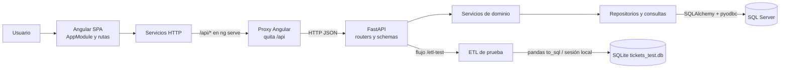

# Arquitectura

## Vista general

El repositorio contiene una aplicación web Angular y una API Python/FastAPI. Angular consume la API por HTTP y recibe respuestas JSON. La API organiza el código en controladores, schemas, servicios y repositorios. SQL Server es el almacén usado por la mayoría de los dominios funcionales; existe además un flujo ETL de prueba que persiste en SQLite.

El proxy `/api` solo está configurado en el servidor de desarrollo Angular. `fronted-tickets/proxy.conf.json` lo dirige a `http://127.0.0.1:8080` y elimina el prefijo antes de reenviar. FastAPI declara CORS para `http://localhost:4200`. No se encontró configuración de proxy o publicación de frontend para producción en los archivos revisados.

## Frontend

La aplicación usa Angular con `AppModule` y `AppRoutingModule`; los componentes se declaran en el módulo raíz. Las rutas de `src/app/app-routing-module.ts` conectan páginas con vistas de inicio, login, SLA, consolidados, importaciones, chat IA, auditoría de categorización, análisis de causa, reporte diario y tareas.

- `components/pages/`: páginas y sus vistas.
- `components/charts/`: gráficos, tablas, KPI y exploradores reutilizables, agrupados por dominio.
- `components/layouts/` y `components/sidenav/`: estructura y navegación.
- `services/`: clientes HTTP Angular; por ejemplo, `HomeService` consulta `api/home/resumen` y `AiChatService` llama a `api/ai-chat/...`.
- `models/`: tipos TypeScript de solicitudes y respuestas.
- `material/`, `material-theme.scss` y `styles.css`: integración de Angular Material y estilos globales.

La visualización usa Chart.js con `ng2-charts`. Los formularios incluyen Reactive Forms y controles Angular Material. No se observa una configuración de estado global dedicada en los archivos revisados.

## Backend

`app/main.py` crea la aplicación FastAPI, instala CORS e incluye los routers. Los controladores reciben solicitudes y dependencias de sesión; los schemas Pydantic describen las entradas y respuestas; los servicios implementan analítica, ETL y lógica de negocio; los repositorios centralizan consultas; los modelos SQLAlchemy representan entidades.

Los routers incluidos cubren autenticación, home, SLA de incidentes/requerimientos, datos consolidados de incidentes/requerimientos/tareas, chat IA, auditoría de categorización, reporte diario, actualizaciones manuales y ETL de prueba. Las rutas detalladas y sus schemas corresponden a `app/controllers/` y `app/schemas/`; el contrato completo aún requiere documentación específica.

El backend también contiene `security/` para crear JWT y `core/` para configuración y CORS. `auth_controller` recibe credenciales y delega el login al servicio de autenticación. El código consultado emite tokens, pero no acredita que el resto de endpoints aplique una dependencia general de autorización; el alcance de protección debe verificarse antes de describirlo como autenticación integral.

## Motores de datos y límites

### SQL Server

`app/database/sqlserver.py` construye una URL SQLAlchemy para SQL Server mediante `pyodbc` y ODBC Driver 18. La configuración lee `DB_SERVER`, `DB_DATABASE`, `DB_USERNAME` y `DB_PASSWORD`; la clave JWT se lee desde `JWT_SECRET_KEY`. `get_sqlserver_db()` proporciona una sesión por solicitud y la cierra al terminar.

Los controladores de SLA, consolidados, tareas, auditoría, reporte diario, login y chat usan esta dependencia según el código revisado. Los modelos principales incluyen datos de incidentes, requerimientos, SLA, tareas, actualizaciones manuales, auditorías de categorización y conversaciones/mensajes de IA. El esquema físico, las relaciones completas y el despliegue de esas tablas no se han cotejado con SQL Server.

### SQLite de ETL de prueba

`app/database/database.py` define una segunda `Base`, `engine` y sesión SQLAlchemy para `assets/tickets_test.db`.

- `POST /etl-test/upload/{tipo}` ejecuta el transformador correspondiente y `export_data.py` escribe el DataFrame a SQLite con `to_sql` y `if_exists="replace"`.
- `GET /etl-test/data/{tipo}` usa `get_db()` (sesión SQLite) y consulta la tabla de prueba.

Este flujo tiene un límite destructivo relevante para sus tablas SQLite: cada carga reemplaza la tabla del tipo correspondiente. Su relación con los datos productivos debe permanecer claramente separada.

### Registro de importaciones de tareas

`ImportRun` declara su tabla sobre la `Base` de `app/database/database.py`, pero `task_consolidated_service` la usa durante la importación de tareas recibida con una sesión SQL Server. SQLAlchemy permite que una sesión trabaje contra una tabla mapeada sin que el motor quede fijado en la clase, pero el destino físico y la existencia de `import_run` en SQL Server requieren confirmación. No se debe inferir de la `Base` cuál base contiene realmente la tabla.

## Flujo de una solicitud

1. Una ruta carga una página Angular.
2. La página usa uno o más servicios HTTP; estos forman paths relativos con prefijo `api/`.
3. En desarrollo, el proxy quita `/api` y envía la petición a FastAPI en el puerto 8080.
4. FastAPI selecciona un router y valida la entrada/respuesta con schemas cuando la ruta los declara.
5. El controlador llama al servicio y le proporciona una sesión de base de datos mediante `Depends`.
6. El servicio coordina reglas de dominio y repositorios; el repositorio ejecuta consultas SQLAlchemy o SQL parametrizado.
7. La API devuelve JSON, que los modelos TypeScript tipan para los componentes Angular.

La ruta de ETL de prueba difiere en el paso de persistencia: el procesamiento de archivo escribe en SQLite; no es una carga a SQL Server.

## Aspectos de arquitectura por confirmar

- Confirmar con el esquema desplegado dónde reside `import_run` y si se espera que el flujo de tareas registre también estado de SQLite.
- Confirmar si los endpoints, aparte del login, requieren y validan JWT en una capa no identificada en los routers revisados.
- Definir y documentar cómo se sirve el frontend, se configura la URL API y se limita CORS en cada entorno.
- Acordar el esquema de migraciones y la fuente de verdad para el DDL de SQL Server.
- Revisar los parámetros ODBC de cifrado con el responsable de la infraestructura antes de documentar su adecuación a producción.
