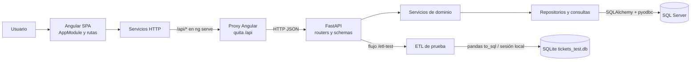
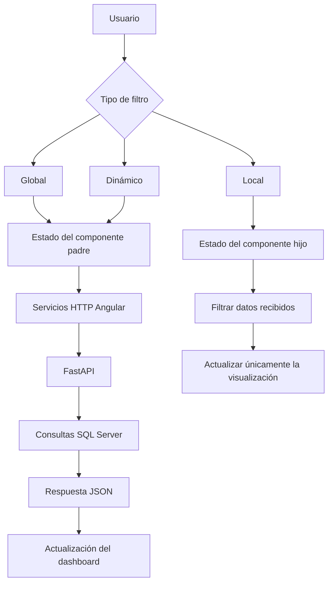

# Arquitectura

## Vista general

El repositorio contiene una aplicación web Angular y una API Python/FastAPI. Angular consume la API por HTTP y recibe respuestas JSON. La API organiza el código en controladores, schemas, servicios y repositorios. SQL Server es el almacén usado por la mayoría de los dominios funcionales; existe además un flujo ETL de prueba que persiste en SQLite.

El proxy `/api` solo está configurado en el servidor de desarrollo Angular. `fronted-tickets/proxy.conf.json` lo dirige a `http://127.0.0.1:8080` y elimina el prefijo antes de reenviar. FastAPI declara CORS para `http://localhost:4200`. No se encontró configuración de proxy o publicación de frontend para producción en los archivos revisados.

## Frontend

La aplicación usa Angular con `AppModule` y `AppRoutingModule`; los componentes se declaran en el módulo raíz. Las rutas de `src/app/app-routing-module.ts` conectan páginas con vistas de inicio, login, SLA, consolidados, importaciones, chat IA, auditoría de categorización, análisis de causa, reporte diario y tareas.

- `components/pages/`: páginas y sus vistas.
- `components/charts/`: gráficos, tablas, KPI y exploradores reutilizables, agrupados por dominio.
- `components/layouts/` y `components/sidenav/`: estructura y navegación.
- `services/`: clientes HTTP Angular; por ejemplo, `HomeService` consulta `api/home/resumen` y `AiChatService` llama a `api/ai-chat/...`.
- `models/`: tipos TypeScript de solicitudes y respuestas.
- `material/`, `material-theme.scss` y `styles.css`: integración de Angular Material y estilos globales.

La visualización usa Chart.js con `ng2-charts`. Los formularios incluyen Reactive Forms y controles Angular Material. No se observa una configuración de estado global dedicada en los archivos revisados.

### Reporte PNG de Auditoría de Categorización

`RequirementCategorizationAudit` reutiliza las cuatro respuestas agregadas existentes (`summary`, `resolvers`, `monthly-stats`, `resolution-reasons`) para construir una instantánea `RequirementCategorizationReportData`. El componente presentacional `app-requirement-categorization-report`, ya declarado en `AppModule`, no realiza HTTP. El contrato del servicio y el backend se mantienen.

- El PNG contiene cinco KPIs, dos distribuciones, Top 10 de colaboradores, gráfico mensual, cuadro mensual completo y Top 10 Estadístico por Colaborador. El explorador de tickets queda excluido; sus cargas, errores y paginación no condicionan la exportación.
- La instantánea copia los filtros efectivos del padre: fechas, grupo, proyecto, resultado, motivo, mes, colaborador y ticket. Los cambios de formulario pendientes de aplicar no alteran el reporte. La selección por ticket sigue filtrando los agregados.
- Cada actualización del dashboard incrementa una versión e invalida la instantánea y el render. Solo cuatro respuestas exitosas, con cantidades y porcentajes válidos y conteos reconciliados, permiten preparar el documento. Un `404` no equivale a una respuesta agregada válida. Cero tickets mantiene la descarga deshabilitada.
- El cuadro mensual usa todos los registros recibidos. La sección 07 reutiliza exactamente las diez filas del gráfico Top 10: incorrectas descendentes, total descendente y nombre. Su pie «Subtotal Top 10» suma únicamente esas filas y calcula los porcentajes desde sus cantidades. Los KPIs y totales generales siguen usando el conjunto completo; la tabla del dashboard conserva su comportamiento y paginación.
- El documento está fuera de pantalla, mide 1400 px de ancho y usa HTML/CSS estático sin animaciones ni fuentes remotas. Espera fuentes disponibles y dos ciclos de pintura, verifica dimensiones y confirma su versión al padre antes de habilitar el botón.
- La descarga usa `html-to-image` existente y captura únicamente `.report-document`. Revalida la instantánea antes y después de capturar, impide descargas simultáneas, limpia el enlace temporal y permite reintentar tras un fallo. Navegar fuera de la página descarta la entrega pendiente.
- La escala es 2, o 1 cuando la altura supera 4000 px. Se rechazan dimensiones finales superiores a 16384 px por lado o 32 millones de píxeles; no se recortan filas ni se reduce automáticamente el documento. En ese caso se informa al usuario para reducir el alcance mediante filtros.

Los endpoints agregados siguen siendo consultas independientes: comprobar conteos reduce inconsistencias detectables, pero no constituye una instantánea transaccional del servidor. La evidencia de validación y los límites pendientes se registran en [TEST_PLAN.md](TEST_PLAN.md#reporte-png-de-auditoría-de-categorización).

### Reporte PNG de Tiempos de Informes Mensuales

`TicketsReportTimes` prepara una instantánea `TicketsReportTimesReportData` con las seis respuestas del dashboard: KPI, volumen mensual, tabla y ranking por resolutor, tabla y ranking por proyecto. El componente `app-tickets-report-times-report`, declarado una sola vez en `AppModule`, es presentacional y no utiliza servicios HTTP. Se reutilizan `TicketsReportTimesService`, sus modelos y `html-to-image`; no se modifican endpoints ni backend.

- El PNG contiene exactamente seis secciones: KPIs de Análisis de Tiempos, Resumen Ejecutivo Mensual, Horas Registradas por Resolutor, Detalle de Tiempos por Resolutor, Horas Registradas por Proyecto y Mes y Detalle de Tiempos por Proyecto. Conserva los cuatro KPIs visibles: tickets, horas, proyectos y resolutores. Los gráficos mantienen el Top 10 existente; las matrices incluyen todas las entidades.
- Las tablas del dashboard reciben páginas de hasta 100 registros mensuales. El padre conserva la primera respuesta y completa únicamente las páginas faltantes mediante los dos endpoints existentes, con una cola compartida de dos solicitudes simultáneas y 30 segundos de espera por petición adicional. Las páginas correctas se conservan para reintentos de la misma versión. La colección del reporte no sustituye la página visible ni modifica sus controles.
- Se comprueban metadatos y cantidad final de registros, claves duplicadas entre páginas, números válidos, igualdad de resúmenes y coherencia de acciones y horas. El margen para sumar cantidades redondeadas es `0.005 × (cantidad de sumandos + 1)` más una tolerancia numérica mínima. Los tickets únicos se toman del KPI/resumen; no se reconstruyen sumando resolutores, proyectos o meses.
- Los filtros del snapshot son fechas, grupo, proyectos y mes efectivamente aplicados. Las búsquedas, indicadores y selecciones locales del dashboard no se exportan. El resumen ejecutivo conserva todo el rango y resalta el mes seleccionado; los KPIs y el detalle sí usan ese mes. El backend actual aplica los proyectos también al KPI y al volumen, aunque la nota del dashboard describe un alcance menor; no se altera esa regla en este cambio.
- Cada recarga o limpieza invalida el reporte y cancela las páginas pendientes. El control de solicitudes descarta respuestas anteriores; una versión adicional de presentación evita aceptar confirmaciones de renderizado anteriores incluso al reintentar con los mismos filtros. El botón espera seis respuestas correctas, tablas completas, datos válidos y confirmación del hijo. Cero tickets mantiene la descarga deshabilitada. Una paginación visual posterior, incluso si falla, no bloquea un snapshot ya completo.
- La presentación utiliza HTML/CSS y SVG estáticos, fuente local y paleta CANVIA. El documento mide 1400 px de ancho, queda fuera del viewport y espera las fuentes y dos ciclos de pintura. Los meses se distribuyen en bloques de hasta seis; las matrices repiten las entidades y la columna «Total del período», identificada expresamente. Los totales de celdas son sumas de horas redondeadas, diferenciadas de los agregados generales.
- El padre captura `.report-document` con `toPng`, `skipFonts` y `skipAutoScale`. Escala 2 hasta 4000 px de altura; escala 1 para documentos más largos. Rechaza lados de salida mayores de 16384 px o más de 32 millones de píxeles y solicita reducir filtros, sin truncar registros. El nombre es `CANVIA-Tiempos-Informes-Mensuales-{desde}_{hasta}-{mes-o-todos}-{fecha-descarga}.png`.
- La captura se valida antes y después de generar la imagen, se impiden descargas simultáneas y se limpia el enlace temporal. Hay mensajes y reintento para páginas, renderizado y captura. Salir de la página descarta la descarga pendiente.

Las consultas independientes no ofrecen una instantánea transaccional SQL Server: se detectan inconsistencias observables, pero cambios concurrentes que preserven los mismos agregados pueden pasar inadvertidos. Las horas representan acciones registradas, no duración calendario ni SLA. Evidencia y pendientes: [TEST_PLAN.md](TEST_PLAN.md#reporte-png-de-tiempos-de-informes-mensuales).

## Backend

`app/main.py` crea la aplicación FastAPI, instala CORS e incluye los routers. Los controladores reciben solicitudes y dependencias de sesión; los schemas Pydantic describen las entradas y respuestas; los servicios implementan analítica, ETL y lógica de negocio; los repositorios centralizan consultas; los modelos SQLAlchemy representan entidades.

Los routers incluidos cubren autenticación, home, SLA de incidentes/requerimientos, datos consolidados de incidentes/requerimientos/tareas, chat IA, auditoría de categorización, reporte diario, actualizaciones manuales y ETL de prueba. Las rutas detalladas y sus schemas corresponden a `app/controllers/` y `app/schemas/`; el contrato completo aún requiere documentación específica.

El backend también contiene `security/` para crear JWT y `core/` para configuración y CORS. `auth_controller` recibe credenciales y delega el login al servicio de autenticación. El código consultado emite tokens, pero no acredita que el resto de endpoints aplique una dependencia general de autorización; el alcance de protección debe verificarse antes de describirlo como autenticación integral.

## Motores de datos y límites

### SQL Server

`app/database/sqlserver.py` construye una URL SQLAlchemy para SQL Server mediante `pyodbc` y ODBC Driver 18. La configuración lee `DB_SERVER`, `DB_DATABASE`, `DB_USERNAME` y `DB_PASSWORD`; la clave JWT se lee desde `JWT_SECRET_KEY`. `get_sqlserver_db()` proporciona una sesión por solicitud y la cierra al terminar.

Los controladores de SLA, consolidados, tareas, auditoría, reporte diario, login y chat usan esta dependencia según el código revisado. Los modelos principales incluyen datos de incidentes, requerimientos, SLA, tareas, actualizaciones manuales, auditorías de categorización y conversaciones/mensajes de IA. El esquema físico, las relaciones completas y el despliegue de esas tablas no se han cotejado con SQL Server.

### SQLite de ETL de prueba

`app/database/database.py` define una segunda `Base`, `engine` y sesión SQLAlchemy para `assets/tickets_test.db`.

- `POST /etl-test/upload/{tipo}` ejecuta el transformador correspondiente y `export_data.py` escribe el DataFrame a SQLite con `to_sql` y `if_exists="replace"`.
- `GET /etl-test/data/{tipo}` usa `get_db()` (sesión SQLite) y consulta la tabla de prueba.

Este flujo tiene un límite destructivo relevante para sus tablas SQLite: cada carga reemplaza la tabla del tipo correspondiente. Su relación con los datos productivos debe permanecer claramente separada.

### Registro de importaciones de tareas

`ImportRun` declara su tabla sobre la `Base` de `app/database/database.py`, pero `task_consolidated_service` la usa durante la importación de tareas recibida con una sesión SQL Server. SQLAlchemy permite que una sesión trabaje contra una tabla mapeada sin que el motor quede fijado en la clase, pero el destino físico y la existencia de `import_run` en SQL Server requieren confirmación. No se debe inferir de la `Base` cuál base contiene realmente la tabla.

## Flujo de una solicitud

1. Una ruta carga una página Angular.
2. La página usa uno o más servicios HTTP; estos forman paths relativos con prefijo `api/`.
3. En desarrollo, el proxy quita `/api` y envía la petición a FastAPI en el puerto 8080.
4. FastAPI selecciona un router y valida la entrada/respuesta con schemas cuando la ruta los declara.
5. El controlador llama al servicio y le proporciona una sesión de base de datos mediante `Depends`.
6. El servicio coordina reglas de dominio y repositorios; el repositorio ejecuta consultas SQLAlchemy o SQL parametrizado.
7. La API devuelve JSON, que los modelos TypeScript tipan para los componentes Angular.

La ruta de ETL de prueba difiere en el paso de persistencia: el procesamiento de archivo escribe en SQLite; no es una carga a SQL Server.

## Aspectos de arquitectura por confirmar

- Confirmar con el esquema desplegado dónde reside `import_run` y si se espera que el flujo de tareas registre también estado de SQLite.
- Confirmar si los endpoints, aparte del login, requieren y validan JWT en una capa no identificada en los routers revisados.
- Definir y documentar cómo se sirve el frontend, se configura la URL API y se limita CORS en cada entorno.
- Acordar el esquema de migraciones y la fuente de verdad para el DDL de SQL Server.
- Revisar los parámetros ODBC de cifrado con el responsable de la infraestructura antes de documentar su adecuación a producción.

## Arquitectura de filtros del dashboard

### Descripción general

CANVIA utiliza tres tipos de filtros para controlar la información presentada en los dashboards: **globales, dinámicos y locales**.

Esta clasificación distingue el mecanismo de interacción del usuario y el alcance de los componentes afectados.

El componente padre Angular coordina los filtros que afectan al dashboard completo, mientras que los componentes hijos pueden administrar sus propios filtros de visualización.

### 1. Filtros globales

Son controles ubicados normalmente en la sección principal de filtros del dashboard.

Permiten definir los criterios generales de consulta antes de solicitar información al backend.

**Características:**

- Se administran desde el componente padre Angular.
- Generalmente utilizan Reactive Forms y Angular Material.
- Se aplican mediante el botón «Aplicar».
- Se incorporan a los parámetros de las solicitudes HTTP.
- Actualizan los KPI, gráficos y tablas que dependen del estado global.
- Deben mantener consistencia entre todos los endpoints analíticos del módulo.

**Ejemplos:**

- Fecha Desde y Hasta.
- Grupo Resolutor.
- Proyecto o conjunto de proyectos.
- Prioridad, estado o categorización, cuando el módulo lo permita.

### 2. Filtros dinámicos

Son filtros activados mediante interacciones directas con las visualizaciones, como seleccionar una barra o un período del gráfico.

A diferencia de los filtros locales, tienen alcance sobre el dashboard y pueden actualizar otros componentes relacionados.

**Características:**

- Se activan mediante eventos de interacción.
- Comunican la selección al componente padre.
- Actualizan el estado compartido de filtros.
- Pueden desencadenar nuevas solicitudes HTTP.
- Permiten seleccionar, cambiar o desactivar un criterio.
- No deben alterar silenciosamente los criterios globales que no estén relacionados.

**Ejemplo en CANVIA:**

En el módulo de Análisis de Tiempos de Informes Mensuales, seleccionar octubre de 2026 en el gráfico mensual establece el filtro `periodo = '2026-10'`.

El componente padre propaga el período seleccionado a los endpoints correspondientes, actualizando los KPI, gráficos y tablas.

Al desactivar la selección, el dashboard recupera el rango temporal establecido por los filtros globales.

### 3. Filtros locales

Son controles pertenecientes a un gráfico o tabla específica. Su objetivo es facilitar la exploración de los datos sin alterar el resto del dashboard.

**Características:**

- Se administran dentro del componente hijo Angular.
- Utilizan variables de estado locales.
- Afectan únicamente la representación del componente.
- No modifican los filtros globales ni dinámicos.
- Normalmente trabajan con datos ya recibidos del backend, sin generar nuevas solicitudes HTTP.
- Pueden implementar búsquedas, selección de meses, ordenamiento o cambios de indicadores.

**Ejemplos en CANVIA:**

- Buscar un resolutor dentro de `app-report-times-resolver-chart`.
- Seleccionar un mes únicamente en el gráfico de horas por resolutor.
- Buscar proyectos o resolutores en una tabla.
- Alternar entre horas, acciones y tickets en una matriz de resultados.

Los filtros locales deben conservar la información original recibida y aplicar la transformación únicamente sobre la vista.

### 4. Diferencias entre filtros

| Característica | Global | Dinámico | Local |
|---|---|---|---|
| Origen | Formulario del dashboard | Interacción con visualizaciones | Control interno del componente |
| Estado | Componente padre | Componente padre | Componente hijo |
| Alcance | Dashboard | Dashboard o componentes vinculados | Componente específico |
| Solicitud HTTP | Generalmente sí | Generalmente sí | No, si filtra datos ya cargados |
| Afecta otros gráficos | Sí | Sí, según el vínculo definido | No |
| Ejemplo | Filtrar por grupo resolutor | Seleccionar una barra mensual | Buscar un resolutor |

### 5. Flujo de aplicación de filtros

### 6. Responsabilidades por capa

**Componente padre Angular**

- Administra los filtros globales.
- Recibe los eventos de filtrado dinámico.
- Mantiene el estado compartido.
- Coordina la actualización de los componentes.
- Controla las solicitudes HTTP, los errores y los estados de carga.

**Componentes hijos Angular**

- Representan los datos mediante gráficos y tablas.
- Administran filtros locales.
- Emiten eventos cuando una interacción debe afectar al dashboard.
- No modifican directamente el estado global del componente padre.

**Servicios HTTP Angular**

- Transforman los filtros del dashboard en parámetros de consulta.
- Invocan los endpoints correspondientes.
- Mantienen los contratos definidos mediante interfaces TypeScript.

**Backend FastAPI**

- Valida los parámetros recibidos.
- Aplica las reglas de filtrado a las consultas.
- Mantiene consistencia entre los indicadores.
- Devuelve resultados agregados y detallados según el endpoint.

**SQL Server**

- Ejecuta las consultas y agrupaciones.
- Aplica condiciones de búsqueda y restricciones de datos.
- Proporciona los registros necesarios para los cálculos analíticos.

### 7. Reglas de implementación

1. Los filtros globales deben mantenerse sincronizados entre los endpoints correspondientes al mismo dashboard.
2. Los filtros dinámicos deben comunicar sus cambios al componente padre mediante eventos o métodos de coordinación.
3. Los filtros locales no deben modificar el estado global ni provocar la actualización de componentes independientes.
4. Al limpiar un filtro dinámico, deben conservarse los filtros globales previamente aplicados.
5. La combinación de filtros debe respetar las reglas de negocio, incluyendo fechas, proyectos y grupo resolutor.
6. Los conteos, porcentajes y agregaciones deben calcularse sobre un conjunto de datos coherente.
7. Los filtros locales sobre resultados paginados deben identificarse como búsquedas sobre datos cargados, salvo que exista búsqueda implementada en el backend.
8. Los componentes deben gestionar estados de carga, errores, resultados vacíos y cambios de filtros sin mostrar información obsoleta.
9. Las nuevas funcionalidades deben identificar explícitamente el tipo y alcance de cada filtro antes de implementarlo.

### 8. Convención de nomenclatura

Para mantener consistencia en el desarrollo y la documentación de CANVIA, se utilizarán las siguientes denominaciones:

- **Filtro global (`Global Filter`):** establece criterios compartidos para el dashboard.
- **Filtro dinámico (`Cross-component Interactive Filter`):** propaga una selección interactiva a otros componentes.
- **Filtro local (`Component-level Filter`):** modifica únicamente la visualización del componente que lo contiene.

Esta clasificación debe utilizarse en nuevos requerimientos, documentación técnica y revisiones de componentes Angular.
