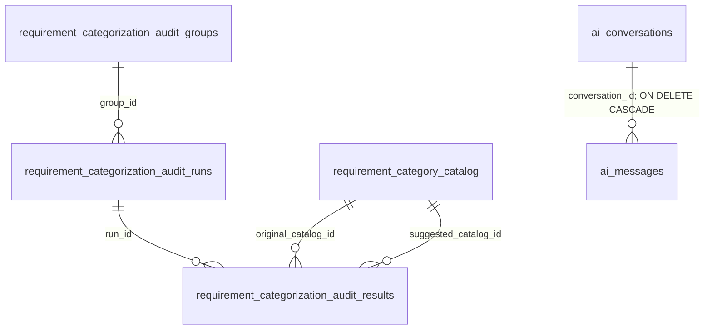

# Esquema de bases de datos

## Alcance y fuente

Este documento describe el DDL versionado en [`schema.sql`](../Gestión_tickets/app/database/schema.sql), contrastado con los modelos y repositorios de `Gestión_tickets/app/` y con [ARCHITECTURE.md](ARCHITECTURE.md). El archivo SQL describe la estructura prevista por el repositorio; no demuestra que una instancia productiva tenga las mismas tablas, restricciones o índices. No se ejecutaron consultas ni se inspeccionó una base de datos.

Se documentan 19 tablas SQL Server. Las columnas se expresan como `nombre tipo [NULL|NOT NULL]`; tipos `NVARCHAR(MAX)` y `VARCHAR(n)` se conservan como aparecen en el DDL. Cuando el tipo aparece agrupado, cada nombre de columna incluido en ese grupo tiene ese mismo tipo y nulabilidad. Las restricciones e índices listados son los explícitos en el DDL revisado; una PK también crea su índice de soporte en SQL Server.

## Motores y responsabilidades

### SQL Server

`app/database/sqlserver.py` crea un engine `mssql+pyodbc` con ODBC Driver 18, sesiones `SQLServerSessionLocal`, `fast_executemany`, `pool_pre_ping` y `pool_recycle`. La URL se arma a partir de configuración externa. Los controladores funcionales usan `get_sqlserver_db()`; por tanto, las tablas de incidentes, requerimientos, SLA, tareas, auditoría, actualizaciones manuales y Centro IA se consultan desde SQL Server en los flujos revisados. Los parámetros de cifrado del cliente están configurados en ese módulo; su adecuación operativa debe revisarse con infraestructura.

### SQLite de prueba

`app/database/database.py` define una segunda `Base`, engine y sesión para `assets/tickets_test.db`. El endpoint `/etl-test/upload/{tipo}` transforma archivos y `etl/export_data.py` escribe el resultado a SQLite mediante pandas `to_sql(if_exists="replace")`; el endpoint de lectura consulta SQLite. Cada carga sustituye la tabla correspondiente y no equivale a una carga productiva a SQL Server. Los nombres y columnas SQLite dependen del DataFrame exportado: no hay tablas de ese flujo declaradas en `schema.sql`, por lo que no se atribuye aquí un DDL fijo.

Hay una excepción de configuración que requiere especial atención: los modelos ORM funcionales heredan de la `Base` importada desde `database.py` (SQLite), pero los servicios/repositorios SQL Server operan esos modelos mediante una sesión SQL Server inyectada. La clase mapeada no fija por sí sola el motor de la sesión; el destino efectivo en estos flujos lo determina la sesión. `ImportRun` hereda igualmente de esa Base y se utiliza en importación SQL Server. Esto explica la intención observada en el código, pero la existencia del objeto en cada base debe validarse por separado.

## Convenciones relacionales y diagrama ER

El diagrama siguiente incluye exclusivamente relaciones declaradas con `FOREIGN KEY` en el DDL. No representa coincidencias de identificadores de tickets, relaciones semánticas ni relaciones definidas solo en Python.

Interpretación de nulabilidad: `group_id`, `original_catalog_id` y `suggested_catalog_id` permiten nulo, así que la fila hija puede no estar asociada. `run_id` y `conversation_id` son obligatorios. El lado padre puede tener cero o muchos hijos; el DDL no declara restricciones adicionales para impedirlo. No hay FK declarada entre SLA y consolidados ni entre `task_consolidated.Ticket_Padre` y otra tabla. `tickets_manual_updates.Ticket_ID` tampoco referencia formalmente una tabla de tickets.

## Inventario por dominio

### Incidentes y requerimientos consolidados

`incident_consolidated` — conjunto consolidado de incidentes.

| Columna(s) | Tipo y nulabilidad |
|---|---|
| `Ticket_ID` (PK) | `VARCHAR(20) NOT NULL` |
| `Fecha_Apertura` | `DATETIME2(0) NOT NULL` |
| `Fecha_Resolucion`, `Fecha_Cierre`, `Fecha_Ultima_Modificacion` | `DATETIME2(0) NULL` |
| `Proyecto` | `NVARCHAR(200) NULL` |
| `ALP` | `VARCHAR(30) NULL` |
| `BU` | `NVARCHAR(50) NULL` |
| `Grupo_Resolutor`, `Nombre_Resolutor` | `NVARCHAR(150) NULL` |
| `Categorizacion_Nivel_1`, `Categorizacion_Nivel_2` | `NVARCHAR(150) NULL` |
| `Categorizacion_Nivel_3` | `NVARCHAR(200) NULL` |
| `Prioridad`, `Urgencia`, `Impacto` | `NVARCHAR(30) NULL` |
| `Estado` | `NVARCHAR(50) NULL` |
| `Motivo_Estado` | `NVARCHAR(100) NULL` |
| `Descripcion` | `NVARCHAR(1000) NULL` |
| `Detalle`, `Solucion`, `Causa` | `NVARCHAR(MAX) NULL` |
| `Fuente_Reportada` | `NVARCHAR(100) NULL` |
| `Motivo_Resolucion` | `NVARCHAR(100) NULL` |

Restricciones/índices: PK `PK_incident_consolidated` sobre `Ticket_ID`; sin FK, CHECK ni índice secundario explícito.

`requirement_consolidated` — conjunto consolidado de requerimientos. Tiene las mismas columnas y definiciones anteriores salvo `Causa`, que no existe.

| Columna(s) | Tipo y nulabilidad |
|---|---|
| `Ticket_ID` (PK) | `VARCHAR(20) NOT NULL` |
| `Fecha_Apertura` | `DATETIME2(0) NOT NULL` |
| `Fecha_Resolucion`, `Fecha_Cierre`, `Fecha_Ultima_Modificacion` | `DATETIME2(0) NULL` |
| `Proyecto` | `NVARCHAR(200) NULL` |
| `ALP` | `VARCHAR(30) NULL` |
| `BU` | `NVARCHAR(50) NULL` |
| `Grupo_Resolutor`, `Nombre_Resolutor` | `NVARCHAR(150) NULL` |
| `Categorizacion_Nivel_1`, `Categorizacion_Nivel_2` | `NVARCHAR(150) NULL` |
| `Categorizacion_Nivel_3` | `NVARCHAR(200) NULL` |
| `Prioridad`, `Urgencia`, `Impacto` | `NVARCHAR(30) NULL` |
| `Estado` | `NVARCHAR(50) NULL` |
| `Motivo_Estado` | `NVARCHAR(100) NULL` |
| `Descripcion` | `NVARCHAR(1000) NULL` |
| `Detalle`, `Solucion` | `NVARCHAR(MAX) NULL` |
| `Fuente_Reportada` | `NVARCHAR(100) NULL` |
| `Motivo_Resolucion` | `NVARCHAR(100) NULL` |

Restricciones/índices: PK `PK_requirement_consolidated` sobre `Ticket_ID`; sin FK, CHECK ni índice secundario explícito.

### Tareas e importaciones

`task_consolidated` — tareas consolidadas.

| Columna(s) | Tipo y nulabilidad |
|---|---|
| `Ticket_ID` (PK) | `VARCHAR(20) NOT NULL` |
| `Ticket_Padre` | `VARCHAR(20) NULL` (sin FK) |
| `Fecha_Apertura` | `DATETIME2(0) NOT NULL` |
| `Fecha_Resolucion`, `Fecha_Cierre`, `Fecha_Ultima_Modificacion` | `DATETIME2(0) NULL` |
| `Proyecto` | `NVARCHAR(200) NULL` |
| `ALP` | `VARCHAR(30) NULL` |
| `BU` | `NVARCHAR(50) NULL` |
| `Grupo_Resolutor`, `Nombre_Resolutor` | `NVARCHAR(150) NULL` |
| `Categorizacion_Nivel_1`, `Categorizacion_Nivel_2` | `NVARCHAR(150) NULL` |
| `Categorizacion_Nivel_3` | `NVARCHAR(200) NULL` |
| `Prioridad`, `Urgencia`, `Impacto` | `NVARCHAR(30) NULL` |
| `Estado` | `NVARCHAR(50) NULL` |
| `Motivo_Estado` | `NVARCHAR(100) NULL` |
| `Descripcion` | `NVARCHAR(1000) NULL` |
| `Detalle` | `NVARCHAR(MAX) NULL` |
| `Fuente_Reportada` | `NVARCHAR(100) NULL` |

Restricciones/índices: PK `PK_task_consolidated` (`Ticket_ID`); no FK/índices secundarios declarados.

`stg_task_consolidated` — staging de la carga de tareas; 23 columnas coincidentes con `task_consolidated`, salvo que todas son `NULL` y no hay PK, FK ni índices. Tipos: `Ticket_ID`, `Ticket_Padre` `VARCHAR(20)`; `Fecha_Apertura`, `Fecha_Resolucion`, `Fecha_Cierre`, `Fecha_Ultima_Modificacion` `DATETIME2(0)`; `Proyecto` `NVARCHAR(200)`; `ALP` `VARCHAR(30)`; `BU` `NVARCHAR(50)`; `Grupo_Resolutor`, `Nombre_Resolutor` `NVARCHAR(150)`; niveles 1 y 2 `NVARCHAR(150)`, nivel 3 `NVARCHAR(200)`; prioridad/urgencia/impacto `NVARCHAR(30)`; estado `NVARCHAR(50)`; motivo estado `NVARCHAR(100)`; descripción `NVARCHAR(1000)`; detalle `NVARCHAR(MAX)`; fuente reportada `NVARCHAR(100)`.

`import_run` — auditoría de ejecución de importaciones, con conteos de filas/tickets, estados por motor y mensaje de error. No tiene CHECK que limite los valores de estado.

| Columna(s) | Tipo y nulabilidad |
|---|---|
| `Eir_ID` (PK) | `INT IDENTITY(1,1) NOT NULL` |
| `Eir_Tipo` | `VARCHAR(50) NOT NULL` |
| `Eir_Nombre_Archivo` | `NVARCHAR(255) NULL` |
| `Eir_Fecha_Inicio` | `DATETIME2(0) NOT NULL` |
| `Eir_Fecha_Fin` | `DATETIME2(0) NULL` |
| `Eir_Estado` | `VARCHAR(20) NOT NULL` |
| `Eir_Filas_Excel`, `Eir_Filas_Aceptadas`, `Eir_Filas_Rechazadas`, `Eir_Tickets_Nuevos`, `Eir_Tickets_Modificados`, `Eir_Tickets_Sin_Cambios` | `INT NOT NULL DEFAULT (0)` |
| `Eir_SQLServer_Status`, `Eir_SQLite_Status` | `VARCHAR(20) NULL` |
| `Eir_Error_Mensaje` | `NVARCHAR(MAX) NULL` |

Restricciones/índices: PK `PK_import_run`; sin FK o índice secundario explícito.

### SLA

`incident_sla` y `requirement_sla` contienen la medición/condiciones de SLA de sus tipos de ticket. Comparten esta estructura:

| Columna(s) | Tipo y nulabilidad |
|---|---|
| `Ticket_ID` (PK) | `VARCHAR(20) NOT NULL` |
| `Proyecto` | `NVARCHAR(100) NULL` |
| `Descripcion` | `NVARCHAR(1000) NULL` |
| `Detalle` | `NVARCHAR(MAX) NULL` |
| `Fecha_Creacion`, `Fecha_Resolucion` | `DATETIME2(0) NULL` |
| `Estado`, `Codigo_Motivo` | `NVARCHAR(50) NULL` |
| `Prioridad` | `VARCHAR(5) NULL` |
| `Usuario_Resolutor`, `Grupo_Resolutor` | `NVARCHAR(100) NULL` |
| `Categorizacion_Clase`, `Categorizacion_Categoria` | `NVARCHAR(100) NULL` |
| `Categorizacion_Tipo` | `NVARCHAR(150) NULL` |
| `SLA_Respuesta_Condicion`, `OLA_Respuesta_Condicion`, `SLA_Solucion_Condicion`, `OLA_Solucion_Condicion` | `NVARCHAR(30) NULL` |
| `Condicion_dia` | `NVARCHAR(15) NOT NULL` |

En cada tabla: PK con nombre `PK_incident_sla` o `PK_requirement_sla`; CHECK `CK_<tabla>_Condicion_dia` restringe a `Lun-Vie`, `Fin Sem.` o `Fuera Horario`. Sin FK ni índice secundario declarado.

### Staging de consolidados y SLA

Las siguientes tablas son buffers de entrada sin clave primaria, FK, CHECK o índices declarados. Todas sus columnas aceptan `NULL`.

| Tabla | Columnas y tipos |
|---|---|
| `stg_incident_consolidated` | `Ticket_ID VARCHAR(20)`; `Fecha_Apertura`, `Fecha_Resolucion`, `Fecha_Cierre`, `Fecha_Ultima_Modificacion DATETIME2(0)`; `Proyecto NVARCHAR(200)`; `ALP VARCHAR(30)`; `BU NVARCHAR(50)`; `Grupo_Resolutor`, `Nombre_Resolutor NVARCHAR(150)`; niveles categorización 1/2 `NVARCHAR(150)`, nivel 3 `NVARCHAR(200)`; prioridad/urgencia/impacto `NVARCHAR(30)`; estado `NVARCHAR(50)`; motivo estado `NVARCHAR(100)`; descripción `NVARCHAR(1000)`; detalle/solución/causa `NVARCHAR(MAX)`; fuente reportada `NVARCHAR(100)`; motivo resolución `NVARCHAR(100)`. |
| `stg_requirement_consolidated` | Igual a `stg_incident_consolidated` salvo que no tiene `Causa`. |
| `stg_incident_sla`, `stg_requirement_sla` | Igual a la estructura de las tablas SLA salvo que no incluyen `Condicion_dia`; todos los campos son nullable. |

### Auditoría de categorización de requerimientos

`requirement_category_catalog` — catálogo de rutas de categorización y procedencia/estado de validación.

| Columna(s) | Tipo y nulabilidad |
|---|---|
| `catalog_id` (PK, identity) | `BIGINT NOT NULL` |
| `level_1`, `level_2` | `NVARCHAR(150) NOT NULL` |
| `level_3` | `NVARCHAR(200) NOT NULL` |
| `description`, `examples` | `NVARCHAR(MAX) NULL` |
| `catalog_source` | `VARCHAR(30) NOT NULL DEFAULT 'SQL_SERVER'` |
| `validation_status` | `VARCHAR(20) NOT NULL DEFAULT 'OBSERVED'` |
| `first_observed_at`, `last_observed_at` | `DATETIME2(0) NULL` |
| `created_at`, `updated_at` | `DATETIME2(0) NOT NULL DEFAULT SYSUTCDATETIME()` |

Restricciones/índices: PK `PK_requirement_category_catalog`; CHECKs `CK_rc_catalog_source` (`SQL_SERVER`, `SERVICE_AIDE`, `MANUAL`), `CK_rc_catalog_validation` (`OBSERVED`, `VALIDATED`) y `CK_rc_catalog_dates` (última observación no anterior a primera, cuando ambas existen); índice único `UX_rc_catalog_route` sobre `(level_1, level_2, level_3)`.

`requirement_categorization_audit_groups` — agrupación de auditorías por grupo resolutor y año.

| Columna(s) | Tipo y nulabilidad |
|---|---|
| `group_id` (PK, identity) | `BIGINT NOT NULL` |
| `group_name` | `NVARCHAR(200) NOT NULL` |
| `grupo_resolutor` | `NVARCHAR(150) NOT NULL` |
| `audit_year` | `SMALLINT NOT NULL` |
| `description` | `NVARCHAR(500) NULL` |
| `created_at` | `DATETIME2(0) NOT NULL DEFAULT SYSUTCDATETIME()` |

Restricciones/índices: PK `PK_rc_audit_groups`; UNIQUE `UQ_rc_groups_resolver_year` en `(grupo_resolutor, audit_year)`; CHECK `CK_rc_groups_year` en rango 2000–2100.

`requirement_categorization_audit_runs` — cabecera y contadores de una corrida de auditoría.

| Columna(s) | Tipo y nulabilidad |
|---|---|
| `run_id` (PK, identity) | `BIGINT NOT NULL` |
| `grupo_resolutor` | `NVARCHAR(150) NOT NULL` |
| `period_from`, `period_to` | `DATE NULL` |
| `status` | `VARCHAR(20) NOT NULL DEFAULT 'PENDING'` |
| `model_name`, `model_version`, `engine_version` | `NVARCHAR(200)`, `NVARCHAR(100)`, `NVARCHAR(50)` NULL respectivamente |
| `catalog_snapshot_hash` | `CHAR(64) NULL` |
| `total_tickets`, `processed_tickets`, `correct_count`, `incorrect_count`, `review_count`, `error_count` | `INT NOT NULL DEFAULT (0)` |
| `created_at` | `DATETIME2(0) NOT NULL DEFAULT SYSUTCDATETIME()` |
| `started_at`, `finished_at` | `DATETIME2(0) NULL` |
| `error_message` | `NVARCHAR(2000) NULL` |
| `group_id` | `BIGINT NULL` |

Restricciones/índices: PK `PK_requirement_categorization_audit_runs`; FK `FK_rc_runs_group` a `groups.group_id`; CHECKs `CK_rc_runs_status` (`PENDING`, `RUNNING`, `COMPLETED`, `PARTIAL`, `FAILED`), `CK_rc_runs_dates` y `CK_rc_runs_counts` (contadores no negativos). El DDL versionado no declara índices secundarios para esta tabla.

`requirement_categorization_audit_results` — resultado por ticket, con categoría original/sugerida, motivo, evidencia y datos de ciclo de vida.

| Columna(s) | Tipo y nulabilidad |
|---|---|
| `result_id` (PK, identity) | `BIGINT NOT NULL` |
| `run_id` (FK) | `BIGINT NOT NULL` |
| `ticket_id` | `VARCHAR(20) NOT NULL` |
| `grupo_resolutor` | `NVARCHAR(150) NOT NULL` |
| `resolver_name` | `NVARCHAR(150) NULL` |
| `project_name` | `NVARCHAR(200) NULL` |
| `source_opened_at` | `DATETIME2(0) NOT NULL` |
| `source_status` | `NVARCHAR(50) NULL` |
| `source_last_modified_at`, `source_resolved_at` | `DATETIME2(0) NULL` |
| `original_level_1`, `original_level_2` | `NVARCHAR(150) NULL` |
| `original_level_3` | `NVARCHAR(200) NULL` |
| `original_catalog_id`, `suggested_catalog_id` (FK opcionales) | `BIGINT NULL` |
| `result_status` | `VARCHAR(10) NOT NULL` |
| `reason_code` | `VARCHAR(60) NOT NULL` |
| `reason_text` | `NVARCHAR(2000) NOT NULL` |
| `evidence_json` | `NVARCHAR(MAX) NULL` |
| `semantic_score` | `FLOAT NULL` |
| `source_hash` | `CHAR(64) NOT NULL` |
| `evaluated_at` | `DATETIME2(0) NOT NULL DEFAULT SYSUTCDATETIME()` |
| `source_status_reason` | `NVARCHAR(100) NULL` |
| `ticket_lifecycle_status` | `VARCHAR(20) NULL` |
| `has_solution` | `BIT NULL` |
| `solution_check_status` | `VARCHAR(24) NULL` |
| `solution_check_reason` | `NVARCHAR(500) NULL` |

Restricciones/índices: PK `PK_requirement_categorization_audit_results`; FKs `FK_rc_results_run`, `FK_rc_results_original_catalog`, `FK_rc_results_suggested_catalog`; CHECK `CK_rc_results_status` (`CORRECT`, `INCORRECT`), `CK_rc_results_evidence_json` (JSON válido si no nulo), `CK_rc_results_lifecycle` (`RESOLVED`, `CANCELLED`, `OPEN`, `UNCERTAIN`) y `CK_rc_results_solution_check` (`PRESENT`, `MISSING_REQUIRED`, `OPTIONAL_MISSING`, `REVIEW_STATUS`); UNIQUE `UX_rc_results_run_ticket` sobre `(run_id, ticket_id)`.

### Centro IA

`ai_conversations` — conversación y estado de contexto JSON.

| Columna(s) | Tipo y nulabilidad |
|---|---|
| `id` (PK, identity) | `INT NOT NULL` |
| `title` | `NVARCHAR(200) NOT NULL DEFAULT N'Nueva conversación'` |
| `created_at` | `DATETIME2(0) NOT NULL DEFAULT SYSUTCDATETIME()` |
| `context_state` | `NVARCHAR(MAX) NOT NULL DEFAULT N'{}'` |

Restricciones/índices: PK `PK_ai_conversations`; CHECK `CK_ai_conversations_context_state` valida `ISJSON(context_state)=1`.

`ai_messages` — mensajes y metadatos/respuestas asociados a conversación.

| Columna(s) | Tipo y nulabilidad |
|---|---|
| `id` (PK, identity) | `INT NOT NULL` |
| `conversation_id` (FK) | `INT NOT NULL` |
| `role` | `NVARCHAR(20) NOT NULL` |
| `content` | `NVARCHAR(MAX) NOT NULL` |
| `created_at` | `DATETIME2(0) NOT NULL DEFAULT SYSUTCDATETIME()` |
| `response_type` | `NVARCHAR(20) NULL` |
| `source` | `NVARCHAR(100) NULL` |
| `filters_json`, `metrics_json`, `evidence_json` | `NVARCHAR(MAX) NULL` |

Restricciones/índices: PK `PK_ai_messages`; FK `FK_ai_messages_conversations` con `ON DELETE CASCADE`; CHECKs de `role` (`user`, `assistant`), `response_type` (`text`, `chart`, `mixed` o NULL) y validez JSON condicional para cada campo JSON; índice no clusterizado `IX_ai_messages_conversation_id_id` en `(conversation_id, id)`.

### Actualizaciones manuales

`tickets_manual_updates` — datos manuales vinculados funcionalmente a un ticket, sin FK de base de datos.

| Columna(s) | Tipo y nulabilidad |
|---|---|
| `Actualizacion_ID` (PK, identity) | `BIGINT NOT NULL` |
| `Ticket_ID` | `VARCHAR(20) NOT NULL` |
| `Fecha_Creacion` | `DATETIME2(0) NULL` |
| `Ticket_type` | `NVARCHAR(50) NULL` |
| `Grupo_Resolutor`, `Nombre_Resolutor`, `Motivo_Resolucion` | `NVARCHAR(150) NULL` |
| `Estado` | `NVARCHAR(50) NULL` |
| `Proyecto` | `NVARCHAR(200) NULL` |

Restricciones/índices: PK llamada `PK_requirement_manual_updates` (nombre histórico aunque la tabla sea `tickets_manual_updates`); índice único no clusterizado `UX_tickets_manual_updates_Ticket_ID` en `Ticket_ID`. El índice implica como máximo una fila por ticket.

`stg_tickets_manual_updates` — filas temporales de la importación manual; staging no agrupado mediante una clave de lote y número de fila.

| Columna(s) | Tipo y nulabilidad |
|---|---|
| `Lote_ID` | `UNIQUEIDENTIFIER NOT NULL` |
| `Fila_Excel` | `INT NOT NULL` |
| `Ticket_ID` | `VARCHAR(20) NULL` |
| `Fecha_Creacion` | `DATETIME2(0) NULL` |
| `Ticket_type` | `NVARCHAR(50) NULL` |
| `Grupo_Resolutor`, `Nombre_Resolutor`, `Motivo_Resolucion` | `NVARCHAR(150) NULL` |
| `Estado` | `NVARCHAR(50) NULL` |
| `Proyecto` | `NVARCHAR(200) NULL` |

Restricciones/índices: PK compuesta `PK_stg_tickets_manual_updates` en `(Lote_ID, Fila_Excel)`; sin FK.

## Importación, staging y deduplicación observados

- El DDL incluye cinco tablas staging SQL Server: `stg_task_consolidated`, `stg_incident_consolidated`, `stg_requirement_consolidated`, `stg_incident_sla`, `stg_requirement_sla`; y `stg_tickets_manual_updates` (seis en total). Las cinco staging consolidadas/SLA aceptan nulos y carecen de clave/índice; la staging manual tiene PK compuesta.
- El servicio de importación de tareas verifica conexión y obtiene un `sp_getapplock` exclusivo ligado a transacción para serializar cargas sobre la staging compartida. Limpia staging, carga por lotes de 90 filas, compara con la tabla oficial y escribe inserciones/actualizaciones y auditoría `import_run` en la misma sesión/commit SQL Server.
- `task_consolidated_etl` exige `Ticket_ID` con prefijo `500-`, fecha de apertura válida y longitudes compatibles con SQL. Normaliza identificadores y ALP, y deduplica `Ticket_ID`: conserva primero filas donde ALP coincide con el código inicial del proyecto y, en empate, la primera fila de Excel. `detectar_cambios` rechaza claves duplicadas tanto en staging como en tabla oficial y clasifica NEW/CHANGED/SAME comparando columnas. En el repositorio de tareas, no hay `UNIQUE` temporal en staging; la unicidad final se apoya en la PK de la tabla oficial y la validación del ETL.
- El inventario de `schema.sql` sí contiene staging para otros dominios, pero no se debe inferir que la ruta de importación de tareas describe los procesos de incidentes, requerimientos o SLA. Los flujos particulares deben verificarse en sus servicios/repositorios y despliegue. `stg_tickets_manual_updates` aparece mapeada en ORM; el DDL solo establece su PK compuesta.
- El proceso ETL de prueba de archivos usa SQLite y `to_sql(..., if_exists="replace")`: reemplaza la tabla del tipo cargado; no es staging SQL Server y su operación tiene semántica destructiva sobre esa tabla de prueba.

## Contraste DDL–SQLAlchemy

El contraste cubre los modelos presentes y los repositorios examinados; es una comparación estática, no una migración ni introspección de catálogo.

| Hallazgo | Evidencia / efecto |
|---|---|
| Modelos funcionales se vinculan a la Base SQLite | Los modelos importan `Base` desde `app.database.database`, mientras las rutas de dominio les pasan sesiones SQL Server. Las sesiones determinan la conexión efectiva; la metadata de esa Base no demuestra ubicación física. Debe confirmarse que los objetos existen en SQL Server y que `create_all` no se usa accidentalmente contra SQLite. |
| `ImportRun` no expresa los defaults del DDL como defaults del servidor | El modelo define `default=0` del lado cliente para contadores y `DateTime` genérico; SQL Server DDL tiene `DEFAULT (0)` y `DATETIME2(0)`. Inserts que omitan esos campos por SQL directo no reciben necesariamente los defaults declarados por ORM. |
| Índices de auditoría divergentes | `requirement_categorization_audit_model.py` define índices `IX_rc_runs_group_created`, `IX_rc_runs_group_period`, `IX_rc_results_run_status` e `IX_rc_results_run_resolver`, que no aparecen en `schema.sql`. El DDL sí coincide para `UX_rc_catalog_route`, `UX_rc_results_run_ticket` y la unicidad de grupos. Si estos modelos se usan para crear tablas, la definición física resultante difiere del DDL versionado. |
| Índices/constraints condicionales ORM | Los modelos de auditoría declaran CHECKs y FKs coincidentes, pero se debe evitar asumir que metadata fue aplicada a una instancia. Los modelos de categorías declaran los índices adicionales antes citados; los modelos SLA no reflejan el CHECK de `Condicion_dia` como constraint ORM. |
| Tabla manual staging | El modelo declara PK compuesta en `(Lote_ID, Fila_Excel)` y tipos compatibles con DDL. El `schema="dbo"` está explícito en el mapeo; no se ve una diferencia de columnas. |
| Centro IA | Los modelos expresan FK, cascada, CHECKs e índice de mensajes presentes en DDL. El DDL usa `NVARCHAR(MAX)` y `DATETIME2(0)`, compatibles con tipos específicos del dialecto MSSQL de esos modelos. |
| Orden físico de columnas incidente | El modelo `IncidentConsolidated` lista `Causa` antes de `Motivo_Resolucion`, mientras DDL lista `Motivo_Resolucion` antes de `Causa`; los nombres y tipos coinciden, por lo que es diferencia de orden, no de contrato nombrado. |
| Modelos de dominio y esquema | Los modelos incidentes, requerimientos, tareas y SLA coinciden en nombres/tipos/nullable de sus columnas principales en lo inspeccionado; los modelos no son fuente suficiente para verificar que producción tenga constraints/índices del DDL. |

## Riesgos de integridad, consistencia y rendimiento

### Confirmados por el DDL o el código

- Las staging de incidentes, requerimientos, tareas y SLA aceptan `Ticket_ID NULL` y no tienen unicidad; pueden contener filas incompletas o repetidas si el proceso de carga no las valida. En tareas, la validación existe en el ETL observado.
- No hay FKs para relaciones semánticas comunes (ticket padre, SLA ↔ ticket, actualización manual ↔ ticket). SQL Server no garantiza que esas referencias tengan destino ni que se mantengan sincronizadas.
- `tickets_manual_updates` permite solo una fila por `Ticket_ID` por su índice único. Un flujo que intente guardar múltiples versiones/historial por ticket chocará con esa regla.
- En auditoría, los CHECK de `ticket_lifecycle_status` y `solution_check_status` no aceptan NULL, pese a que ambas columnas están declaradas nullable. SQL Server CHECK acepta `UNKNOWN` (por ejemplo, NULL), de modo que NULL sí puede persistir; no equivalen a `NOT NULL`.
- Los índices de las tablas consolidadas se limitan a PK en el DDL. Filtros frecuentes por fecha, estado, proyecto o grupo pueden requerir escaneo a medida que crece el volumen; el impacto real depende de cardinalidad y planes, que no se midieron.
- La comparación de cambios de tareas trabaja en memoria con DataFrames completos de staging/oficial coincidente; el costo de memoria y tiempo aumenta con el tamaño de cada importación.
- En SQLite de prueba, `if_exists="replace"` reemplaza el contenido/definición de la tabla con cada carga; es comportamiento implementado y puede eliminar filas anteriores.

### Hipótesis a validar

- Sin índices secundarios en las tablas consolidadas, filtros y ordenamientos de dashboards podrían degradarse con crecimiento. Medir consultas reales y planes antes de proponer índices.
- La staging de tareas se vacía y reutiliza. El bloqueo de aplicación serializa importaciones que usen exactamente ese recurso; operaciones ajenas o cargas paralelas que no adquieran el mismo bloqueo podrían interferir.
- `UX_tickets_manual_updates_Ticket_ID` puede ser demasiado restrictivo si el requerimiento real es guardar historial; confirmar regla funcional antes de cambiarlo.
- La divergencia de índices de auditoría entre modelo y DDL puede causar diferencias si se utiliza `metadata.create_all` o se aplican cambios manuales; no se encontró en este análisis prueba de que eso ocurra en despliegue.
- Las columnas textuales `NVARCHAR(MAX)` para detalle, solución, evidencia y contexto JSON admiten valores grandes; almacenamiento, transferencia y consultas pueden crecer sensiblemente. No se dispone de tamaños ni métricas productivas.

## Pendiente de validación

1. Comparar el DDL con el catálogo de cada instancia SQL Server para confirmar tablas, tipos, constraints, índices, opciones de nulabilidad y versión desplegada.
2. Confirmar en qué base se creó `import_run` y las demás tablas, y que el engine SQLite no sea considerado accidentalmente su destino por la metadata compartida.
3. Completar el rastreo de carga de incidentes, requerimientos, SLA y actualizaciones manuales para determinar si sus tablas staging se usan, cómo se limpian y qué deduplicación/validación aplica cada proceso.
4. Confirmar si `tickets_manual_updates` representa estado actual o historial, dada la unicidad de `Ticket_ID`.
5. Revisar índices con consultas y planes de producción; no inferir una necesidad de indexación solo a partir del DDL.
6. Confirmar consistencia de estados y contadores de `import_run` entre los procesos de cada dominio; el DDL permite valores libres y no enlaza ejecuciones con filas staging.

## Referencias de implementación

- [`schema.sql`](../Gestión_tickets/app/database/schema.sql): DDL versionado.
- [`sqlserver.py`](../Gestión_tickets/app/database/sqlserver.py) y [`database.py`](../Gestión_tickets/app/database/database.py): engines y sesiones.
- Modelos: `Gestión_tickets/app/models/`.
- ETL y repositorios: `Gestión_tickets/app/etl/`, `Gestión_tickets/app/repositories/`.
- [ARCHITECTURE.md](ARCHITECTURE.md): límites funcionales de SQL Server y SQLite.
